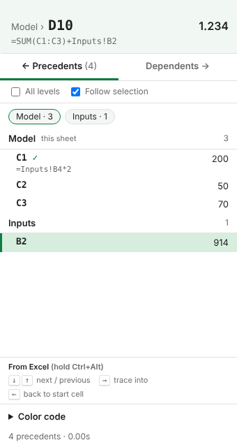

# Trace & Color: an Excel add-in

Trace **precedents and dependents** in very large workbooks, and **color-code a whole model in one click** using the standard financial-modeling convention.

| Color | Meaning |
|---|---|
| 🔵 **Blue** on light yellow 🟨 | Hard-coded inputs: typed numbers, and "fake formulas" like `=1000` or `=12*1.05` |
| ⚫ **Black** | Formulas that only use the same sheet |
| 🟢 **Green** | Formulas linking to **other sheets** |
| 🔴 **Red** | Formulas linking to **other workbooks** |

**Only numbers are colored.** Text, dates, times, TRUE/FALSE, blanks, and formulas that *return* text or dates (like `="FY"&A1` or `=EOMONTH(…)` timeline headers) keep whatever font color they already have. Input cells also get a light yellow background (`#FFFFCC`, the classic input yellow), so they stand out. You can change any color or switch the background off in the task pane. You can also click **match selected cell** to copy the fill from a cell your model already uses for inputs. The add-in remembers your choice.



---

## Install (nothing to run, IT-compliant)

The add-in is a single settings file, [`manifest.xml`](https://github.com/serra-verdaguer/excel-trace-color/blob/main/manifest.xml). There's no program, macro or script to execute. Pick one route:

### A. Team network drive: stays on the ribbon, no admin rights
1. Download [`manifest.xml`](https://github.com/serra-verdaguer/excel-trace-color/blob/main/manifest.xml) (↓ *Download raw file*) and put it in a folder on a shared network drive, e.g. `S:\Finance\Tools\TraceColor`.
2. Find the folder's network path (starting with `\\`). In File Explorer → *This PC*, the drive shows as e.g. *Finance (\\server01\data) (S:)*, so the folder is `\\server01\data\Finance\Tools\TraceColor`.
3. Excel → `File` → `Options` → `Trust Center` → `Trust Center Settings` → **`Trusted Add-in Catalogs`**. Paste the path in *Catalog Url* → **Add catalog** → tick **Show in Menu** → OK.
4. Restart Excel → `Home` → `Add-ins` → `More Add-ins` → **`SHARED FOLDER`** → *Trace & Color* → **Add**.

Teammates only need steps 3 and 4.

### B. Quick try: Upload My Add-in
Download `manifest.xml` → Excel → `Home` → `Add-ins` → `More Add-ins` → `My Add-ins` → **`Upload My Add-in`**. Excel may forget an add-in uploaded this way after a restart.

### C. Whole company: IT deploys it (zero clicks per person)
An IT admin uploads `manifest.xml` once in **Microsoft 365 admin center → Settings → Integrated apps → Upload custom apps**. The tab then appears for everyone automatically.

*For IT:* this is a standard Office web add-in (JavaScript, no VBA, .exe or COM). It asks only for the **ReadWriteDocument** permission (the open workbook) and sends no data anywhere.

Updates are automatic. The add-in's code is served from GitHub Pages, so everyone gets the new version the next time Excel starts.

## Use

### Ribbon: Trace & Color tab

| Button | What it does | Shortcut |
|---|---|---|
| **Precedents** | Cells the selected cell reads from (one level) | `Ctrl+Alt+Shift+P` |
| **All Precedents** | Everything upstream, all levels | |
| **Dependents** | Cells that use the selected cell (one level) | `Ctrl+Alt+Shift+D` |
| **All Dependents** | Everything downstream, all levels | |
| **Trace Pane** | Opens the pane | `Ctrl+Alt+Shift+T` |
| **Color Code** | Colors the **selection** if more than one cell is selected, otherwise the **whole sheet** | `Ctrl+Alt+Shift+C` |
| **Color Workbook** | Colors every sheet | |

On Mac the shortcuts use `⌘ ⌥ ⇧` instead of `Ctrl Alt Shift`.

### Trace pane
- **Click any cell.** The top of the pane shows that cell (sheet, address, value and formula), and its precedents appear below, grouped by sheet.
- **Move with the keyboard, straight from the Excel grid** (no need to click the pane):

  | Keys | Action |
  |---|---|
  | `Ctrl+Alt+↓` / `Ctrl+Alt+↑` | Next / previous precedent. Excel jumps to it. `↑` past the first one returns to your cell |
  | `Ctrl+Alt+→` | Trace into the current one (it becomes the cell at the top) |
  | `Ctrl+Alt+←` | Back to the cell at the top. Press again to go up one level |

  Inside the pane, the plain arrow keys do the same, plus `Esc` for the start cell. On Mac use `⌘ ⌥` + arrows.
- **Sheet chips** (e.g. `Model · 3`, `Inputs · 1`) show which sheets the references come from. Click one to jump there.
- The trail at the top (e.g. `Model!D10 › Model!C1`) shows how you got there. Click any step to go back to it.
- **Precedents / Dependents** tabs switch direction. **All levels** shows everything upstream or downstream.
- **Follow selection** (on by default) re-traces whenever you click a new cell in Excel.
- A filter box appears automatically when there are more than 15 results.

## Built for huge workbooks

- **Tracing uses Excel's own dependency engine** (`getDirectPrecedents`, `getPrecedents`, `getDirectDependents`, `getDependents`). Results come back as *rectangles*, so `=SUM(A1:A1000000)` returns one row, not a million. Lists render 200 rows at a time, with a *Show more* button.
- **Color coding skips what doesn't matter.** Excel's `SpecialCells` finds the numeric constants and formulas on its side, so labels and empty space are never read. Only those areas are read, in chunks of about 40k cells, to get the formula, result type and number format.
- **One check per distinct formula.** A formula copied down 1M rows is the same R1C1 string, so it is checked once and then served from a cache. Number formats (for spotting dates) are cached the same way.
- **Rectangle compression.** Cells of the same color merge into the fewest possible rectangles before painting, so a 1M-row column becomes one format call.
- **Adaptive chunking.** If Excel refuses a payload as too large, the chunk size halves and the add-in retries automatically. Calculation and screen updating are suspended while it paints.
- If `SpecialCells` isn't available, or the sheet is extremely fragmented, the add-in falls back to a full chunked scan.

## Requirements and limits
- Excel for **Microsoft 365** (Windows or Mac), or **Excel on the web**. Excel 2016/2019 perpetual versions don't support the APIs this uses.
  - *All Precedents* needs ExcelApi 1.14, and *All Dependents* needs 1.15. The pane tells you if your build is too old.
- Excel's API doesn't follow references **into other workbooks** when tracing. Those cells are still colored red by Color Code.
- Office add-ins can't undo their changes with **Ctrl+Z**. Save before running *Color Workbook* on a model you care about.
- Font color only. Fills, borders and number formats are never touched.

## Develop

```bash
npm test                 # unit tests + a 200k-row simulated sheet
node scripts/set-base-url.js https://<you>.github.io/<your-fork>   # repoint manifest after forking
```

Hosting: GitHub Pages serves the repo root (*Settings → Pages → Deploy from branch → `main` / root*). There is no build step: the add-in is plain HTML/JS in [`addin/`](addin/).

| File | Purpose |
|---|---|
| `manifest.xml` | Ribbon tab, buttons and URLs |
| `addin/lib/core.js` | Pure logic: formula classification, rectangle compression, chunk planning (unit-tested) |
| `addin/lib/colorcode.js` | Color-coding pipeline |
| `addin/lib/trace.js` | Precedent/dependent tracing and navigation |
| `addin/app.js` | Task pane UI, ribbon commands and keyboard shortcuts (shared runtime) |

MIT licensed.
